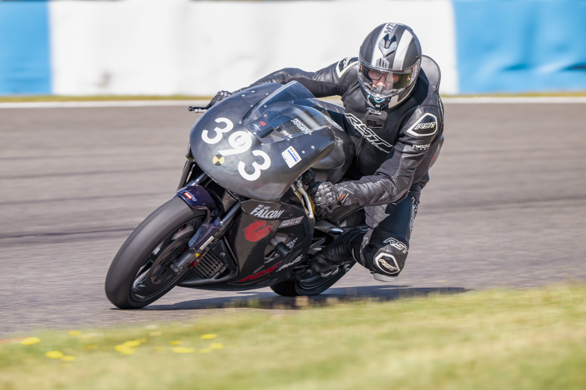
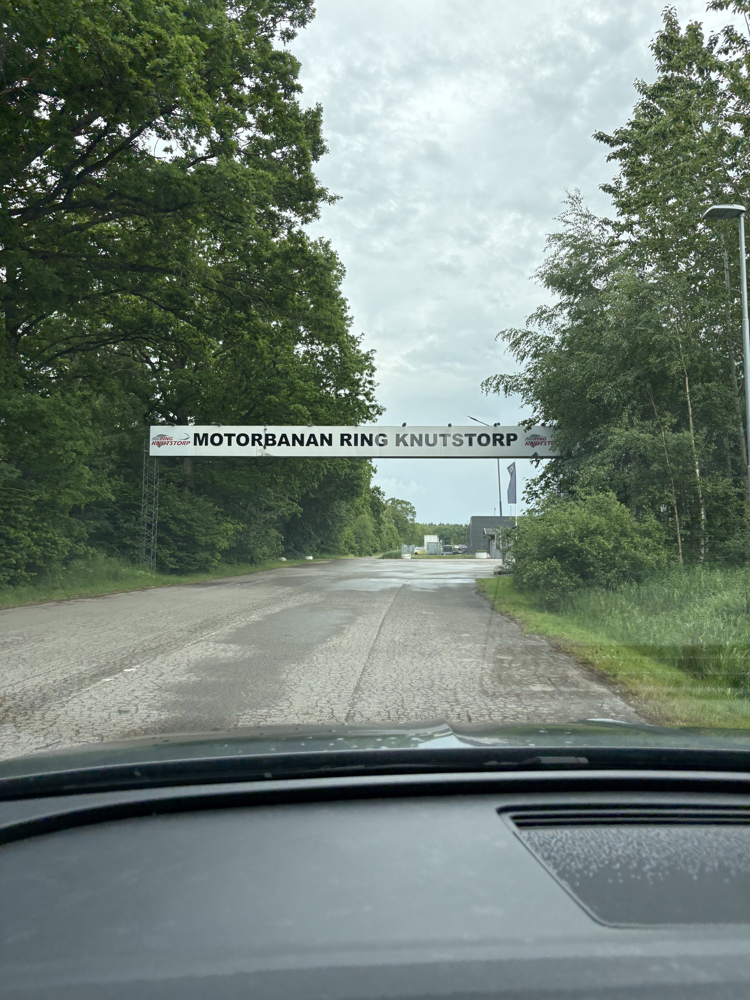
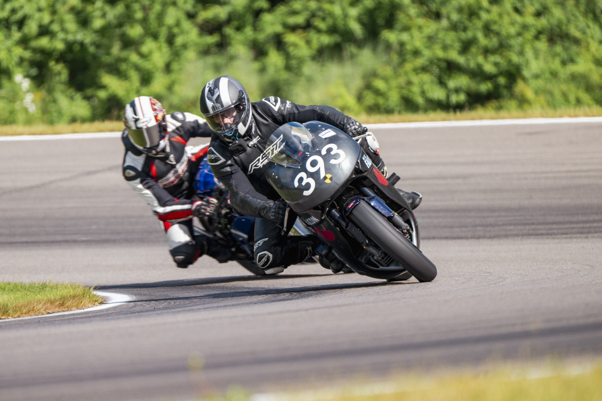
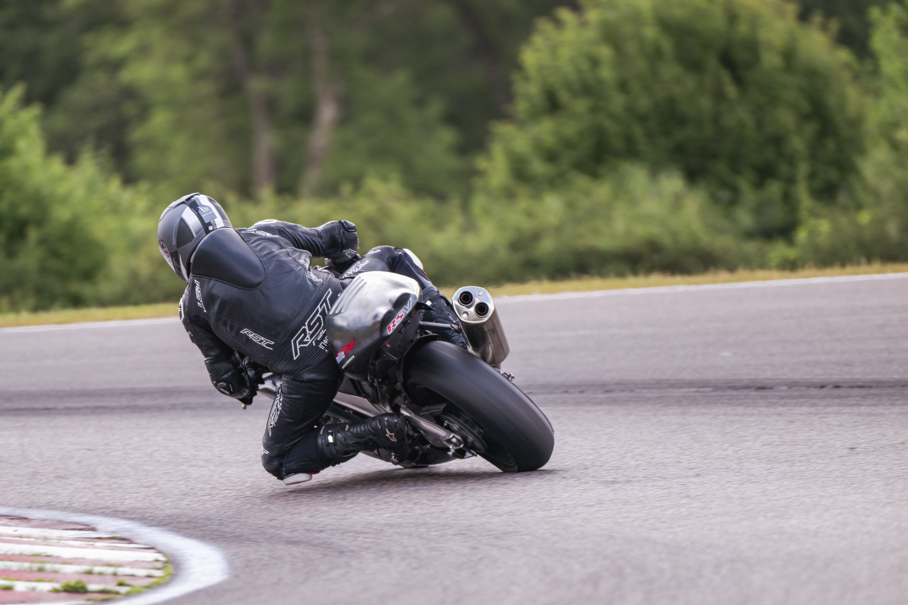
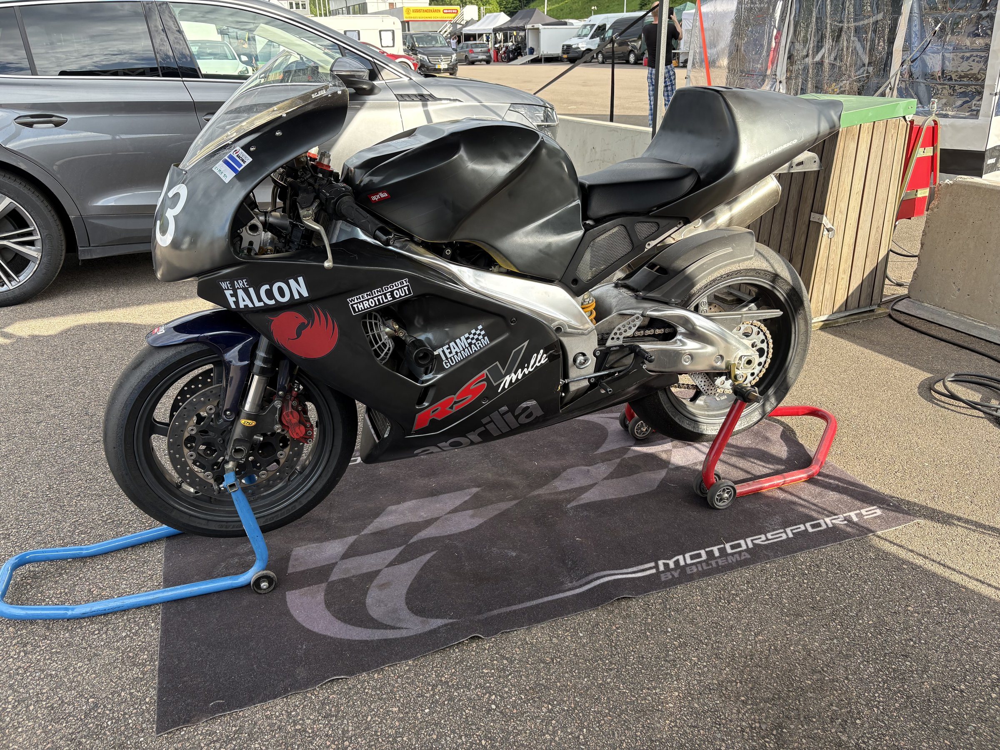

+++
date = '2026-11-10'
draft = false
title = 'Alene af sted til Knutstorp'
description = 'Årets første tur til Knutstorp. To dage alene af sted, en dag med rigtig god kørsel og en dag med regn.'
type = 'post'
tags = ['motorcycles']
+++

*Foto: Morten Kimer / Kimers Foto*

Årets første tur til Knutstorp for mit vedkommende.

Det blev en 2-dages tur alene af sted. Daniel havde andre forpligtelser.

En dag med rigtig god kørsel, en dag med regn (man fornemmer et [tema](/posts/velkommen-til-anderstorp-i-regnvejr/)).

*Fotos: Morten Kimer / Kimers Foto*

