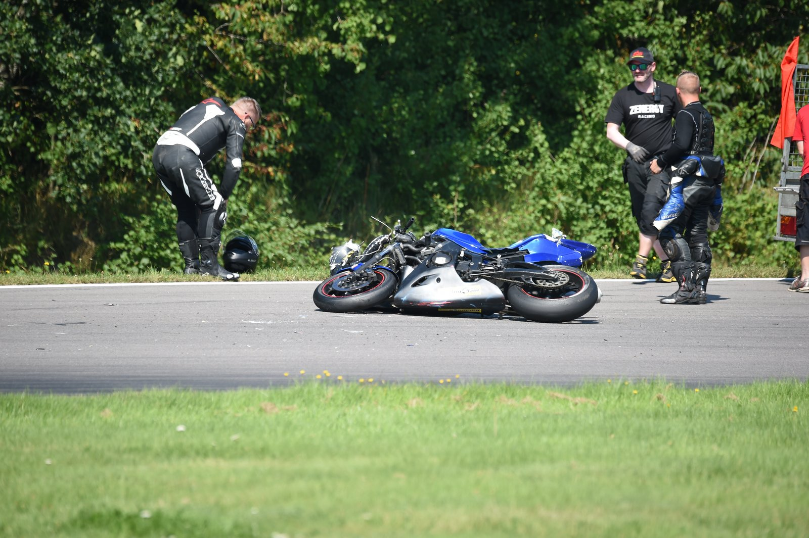

+++
date = '2026-11-23'
draft = false
title = 'Første trackday, første styrt'
description = 'Min første trackday føltes som det sikreste sted, jeg nogensinde havde kørt. Om søndagen rullede jeg hen ad asfalten i små 100 km/t. Helt min egen skyld.'
type = 'post'
tags = ['motorcycles', 'lessons-learned']
+++

*Foto: Morten Kimer / Kimers Foto*

Min første trackday føltes som det sikreste sted, jeg nogensinde havde kørt. Om søndagen styrtede jeg.

For nogle år siden var jeg på et motorcykelkursus på bane med instruktør og fandt ud af, at det nok var det sjoveste, jeg kunne lave helt alene. Lidt research og lidt sjælesøgning senere havde jeg købt en dedikeret banecykel og meldt mig til min første trackday.

## Fredag aften på Knutstorp

Sent fredag aften kørte jeg til Ring Knutstorp i Sverige med cyklen på min nye, brugte trailer. Lørdag og søndag på banen. Jeg slog lejr, da jeg kom frem, og næste morgen opdagede jeg, at jeg var landet ved siden af de flinkeste naboer. De svarede på alle mine nybegynderspørgsmål og var præcis lige så begejstrede for at være der som mig. Jeg har siden lært, at alle naboerne i paddocken er flinke, og at alle simpelthen står og tripper for at komme ud. Det er derfor, vi gør det :-)

Jeg havde aldrig kørt på Knutstorp før, men jeg havde set en stak onboard-videoer på YouTube, så jeg vidste i det mindste, hvor den gik hen. Jeg startede i begyndergruppen, og så rykkede jeg op og gav den gas.

Det. Bedste. Kick. Nogensinde.

Og det føltes helt trygt. Ingen træer, ingen modkørende og i hvert fald ingen bilister med næsen i telefonen, der passivt prøver at slå alle omkring sig ihjel. Man kunne bare fyre til den, som evner og mod rakte. Så det gjorde jeg.

Jeg blev hurtigere for hver session den første dag. Lørdag aften sad jeg med nogle af de andre over en kold øl, byttede historier og sugede stemningen til mig.

## Søndag, tredje session

Søndag morgen var jeg helt oppe at køre. Første session: varme op. Anden session: hurtigere igen. Jeg kunne ikke vente på den tredje, eller på løbet om eftermiddagen, hvor jeg helt sikkert skulle ende langt længere fremme end om lørdagen. Overmodet havde fuldstændig taget over.

Tredje session, første hele omgang. Jeg kom op bag en langsommere kører og tænkte: "Ham tager jeg lige før hårnålen, der er masser af plads." Jeg lagde an gennem venstresvinget, gav fuld gas - og pludselig rullede jeg hen ad asfalten i små 100 km/t og lyttede til min hjelm redde mit hoved, mens cyklen lavede meget dyre lyde i baggrunden.

Jeg ved ikke, hvor mange gange jeg rullede. Alt gik i slowmotion, og jeg nåede at have en hel samtale med mig selv, mens jeg ventede på at ligge stille: "Husk at slappe af i kroppen, så den er mere fleksibel. Åh nej, jeg kan ikke lide den lyd, min nye hjelm laver mod asfalten, den er ødelagt nu. Hmm. Jeg tror ikke, jeg bevæger mig mere. Vent lige et sekund og tjek igen. Nej, ligger stadig stille. Så ligger jeg altså på en racerbane. Jeg burde nok flytte mig. Mon jeg kan?"

Og det var ikke engang hele tankerækken for de par sekunder.

*Foto: Morten Kimer / Kimers Foto*

Fysisk var jeg okay. Ingen brækkede knogler, bare rystet, og så de mørkeste blå mærker, jeg nogensinde har haft. De var nærmest kulsorte og gjorde ondt i et par uger.

## Hvad skete der?

Ham, jeg ville overhale, var allerede ved at blive overhalet af en anden, og det havde jeg overset. Den overhaling var lidt tættere, end han brød sig om, så han flyttede sig for at give plads. Lige ind foran mig.

Helt min egen skyld. På banen er det dig, der skal overhale rent. Ham foran har ingen spejle og kører bare sit eget løb.

## Et vinterprojekt

Cyklen blev et godt vinterprojekt. Jeg skulle stort set lave alt foran og bagved motoren.

Den kom tilbage på banen sæsonen efter ... og så solgte jeg den og holdt pause fra banen et stykke tid. Det føltes ikke sikkert længere. Jeg kunne ikke komme i zonen, fordi mine egne tanker hele tiden kom i vejen, så det føltes faktisk mere skræmmende end at køre på landevejen.

Det tog tid og rigtigt arbejde at finde mojoen igen.

Jeg havde slet ikke set hele risikoen. En racerbane er et sikkert sted at køre stærkt. Det gør den ikke til et sted, hvor fejl er uden konsekvenser.
