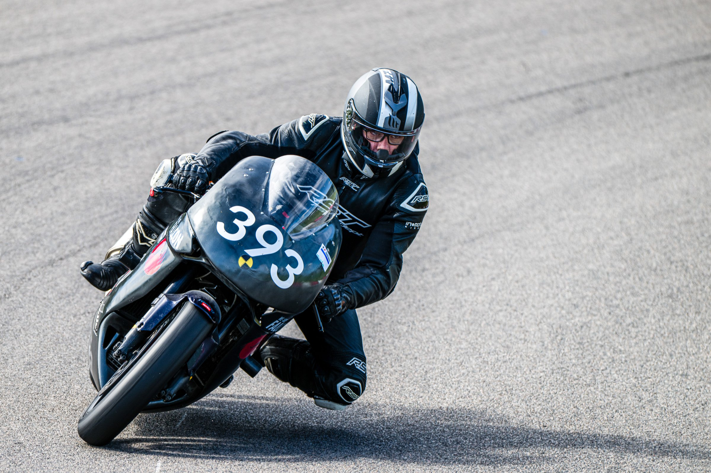
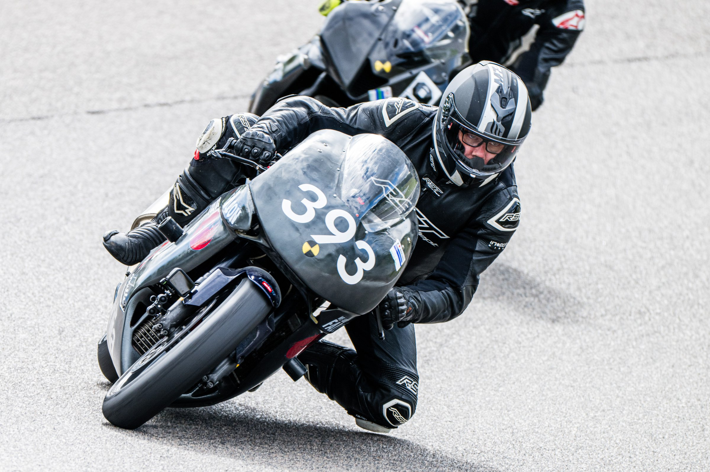
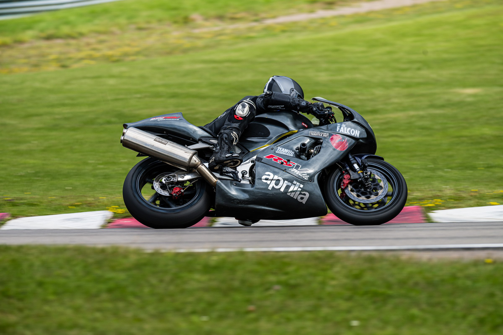
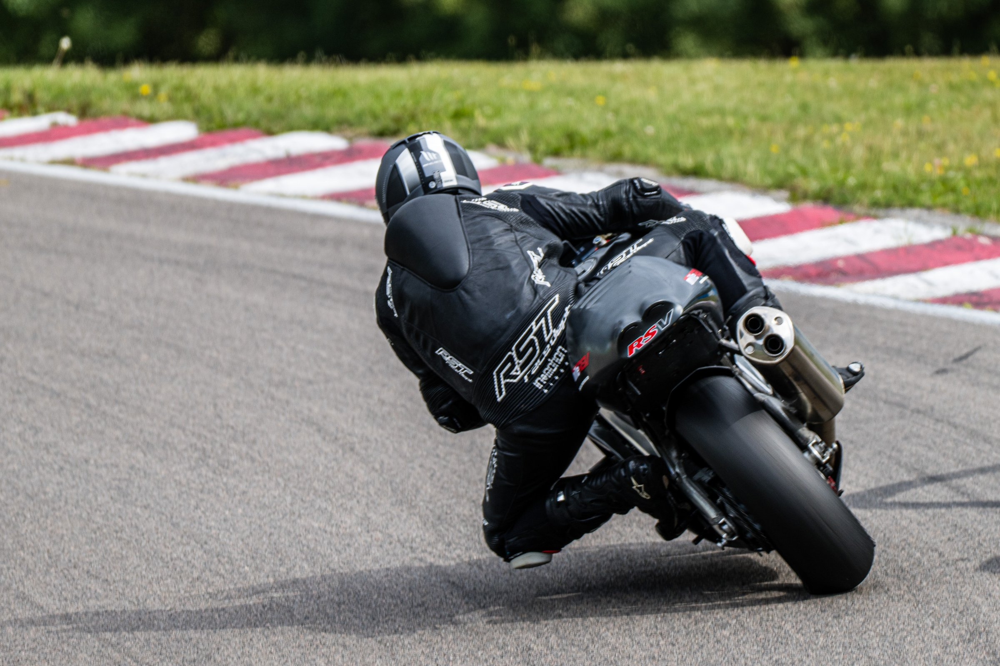
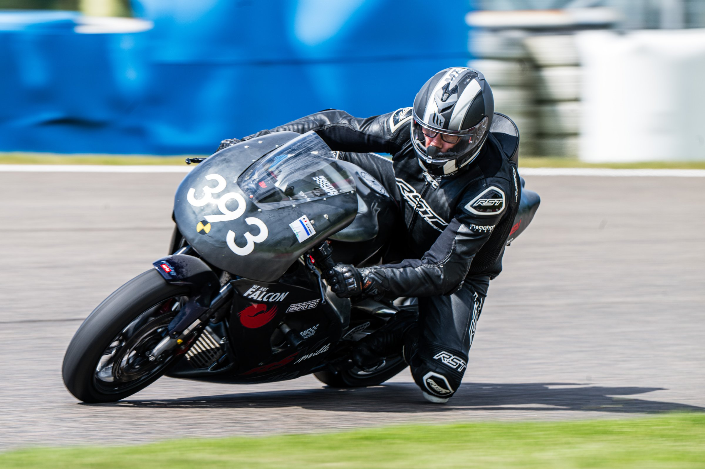

+++
date = '2026-11-17'
draft = false
title = 'Godt vejr for en gangs skyld'
description = 'Årets anden tur til Knutstorp med Daniel. Kørsel fredag og søndag, flagpost lørdag, og faktisk godt vejr for en gangs skyld.'
type = 'post'
tags = ['motorcycles']
+++

*Alle fotos: Morten Kimer / Kimers Foto*

Årets anden tur til Knutstorp.

For et par uger siden skrev jeg om [årets første tur til Knutstorp, alene af sted](https://teamgummiarm.dk/posts/alene-af-sted-til-knutstorp/).

Daniel var med denne gang, til en lang weekend. Vi kørte fredag, sad flagposter lørdag og kørte igen søndag. Masser af god fart i cyklerne, og faktisk godt vejr for en gangs skyld :-)

Det var lidt koldt lørdag som flagposter, men fredag og søndag kunne man absolut ikke klage over. Godt 20 grader, tørt, og masser af god asfalt.

