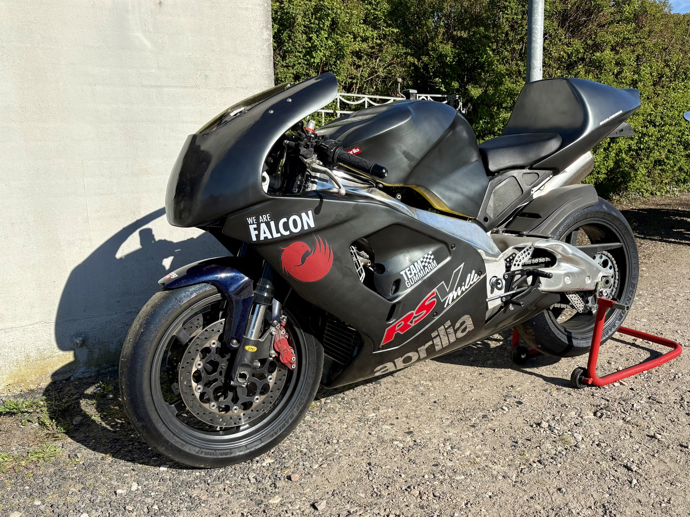
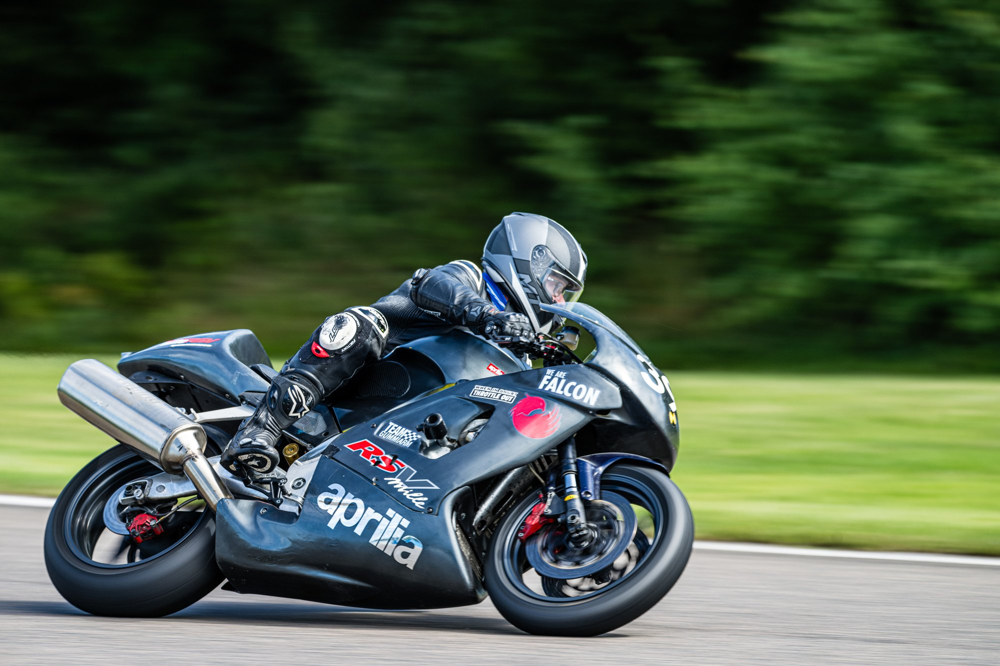

+++
date = '2026-10-20'
draft = false
title = 'Nye farver til sæsonen'
type = 'post'
description = 'Ny sponsor, ny lak og et par logoer på den gamle Aprilia. Kåben fik glasfiber og maling i garagen, og så ramte vi regnvejret på årets første tur.'
tags = ['motorcycles']
+++

Jeg er en anelse bagefter med sæsonens opslag, but here goes :-)

I vinters meldte [We Are Falcon](https://wearefalcon.tv/) sig på banen som sponsor til det lille MC-hold. Cyklen blev derfor lidt mere ensartet i farven, og der kom et par logoer hjem til at pryde siden på den gamle maskine.

Det var samtidig en god mulighed for at øve mig lidt med glasfiber, så jeg fik fikset et par revner i den gamle kåbe. Bagefter lakerede jeg den selv i garagen i foråret. Heldigvis var forårsvejret godt, så det kunne lade sig gøre.

Som man jo bør, var jeg færdig med projektet med hele to dage i overskud, inden vi skulle af sted. Til gengæld ramte vi så regnvejret på årets første tur.

*Foto: Morten Kimer / Kimers Foto*
