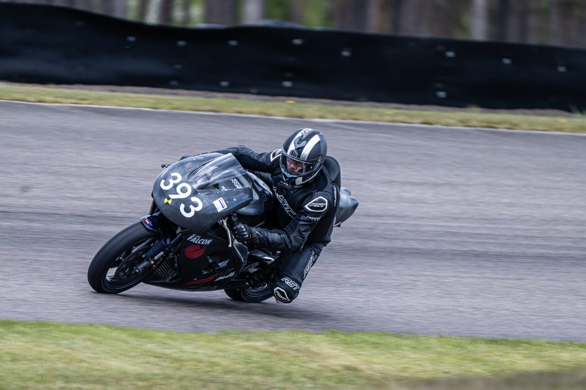
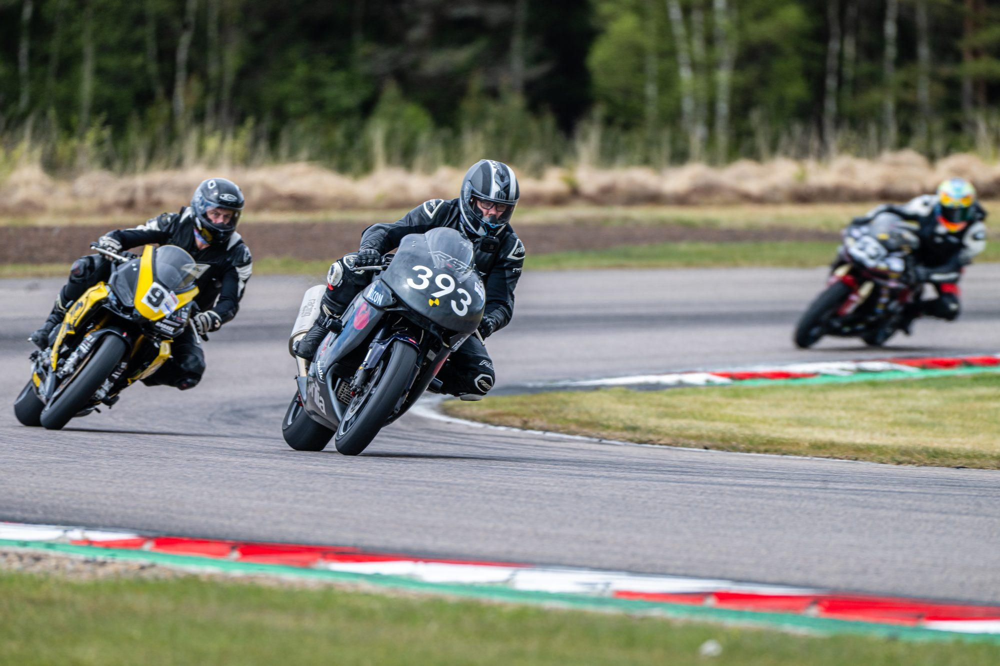
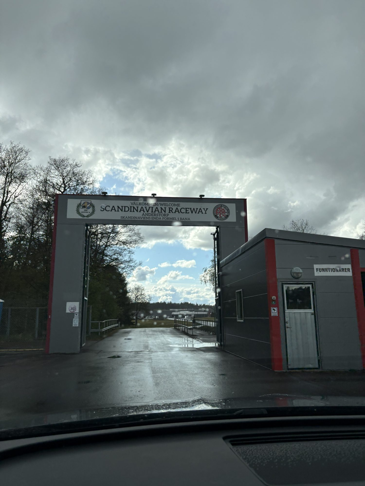
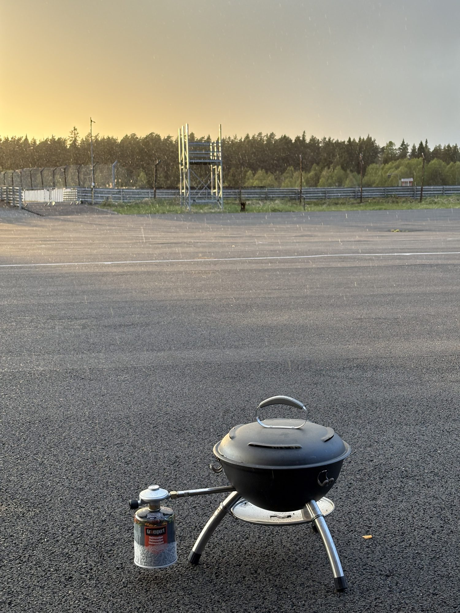

+++
date = '2026-10-27'
draft = false
title = 'Velkommen til Anderstorp i regnvejr'
type = 'post'
tags = ['motorcycles']
+++

Anderstorp kan noget andet! Hvor Knutstorp er en lille snoet bane, hvor alle sving hænger sammen og en fejl nærmest straffer dig halvdelen af banen, så er Anderstorp mere armen i karmen, bundgas og så op til det næste sving, så du kan få lov at bremse igen.

*Fotos (billede 1 og 2): Morten Kimer / Kimers Foto*

Vi ankom i regnvejr torsdag aften. Fredag var en dag med masser af banetid, men jeg havde svært ved rigtig at finde en rytme. Lørdag gik med at være flagpost, og søndag regnede mere eller mindre væk for os. Daniel havde dæk, som godt kunne tåle lidt fugt, så han fik kørt lidt - mine slicks skulle ikke nyde noget af den våde asfalt.

